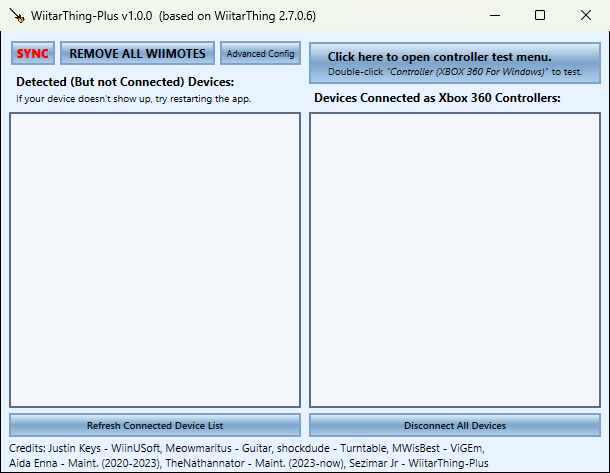
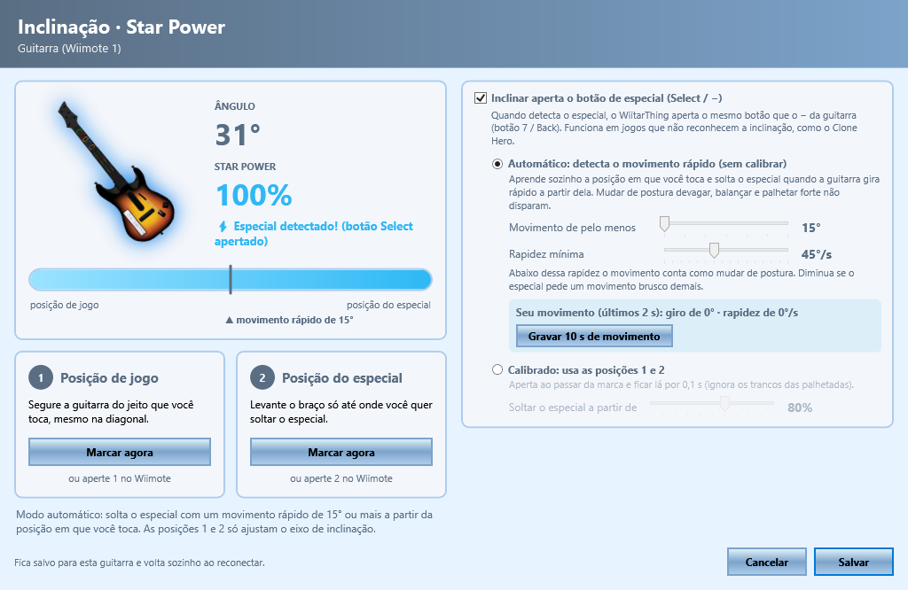
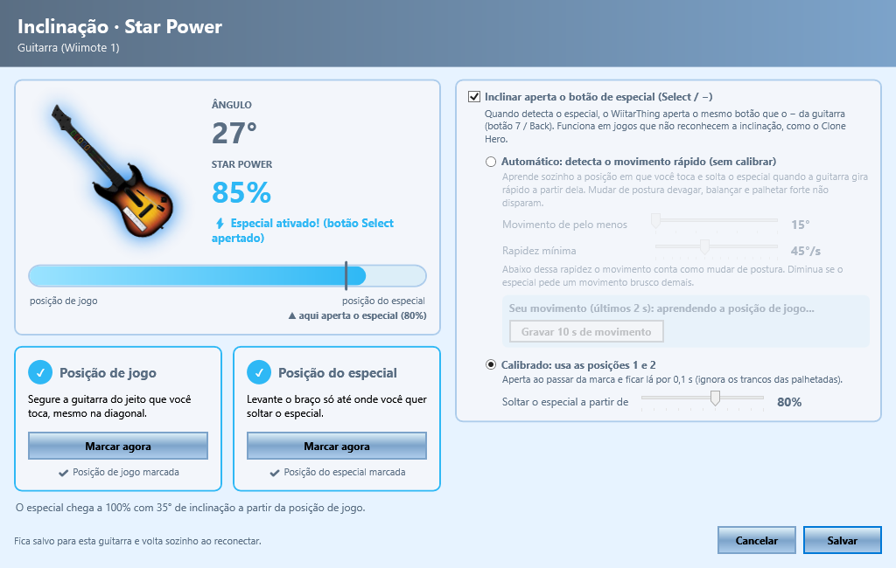

# WiitarThing-Plus

Programa que conecta as guitarras, baterias e toca-discos de Guitar Hero do Wii ao PC com Windows, sem fio, usando um Wiimote e Bluetooth. Eles funcionam no Clone Hero, no YARG e em outros jogos como controles de Xbox 360.

O **WiitarThing-Plus** é uma versão melhorada do [WiitarThing](https://github.com/TheNathannator/WiitarThing), baseada na versão 2.7.0.6. Ele corrige travamentos e problemas de conexão, reconhece a guitarra de primeira e facilita o especial (Star Power): tem uma tela de calibração ao vivo e um modo automático que solta o especial com um movimento rápido da guitarra, sem calibrar nada.

🇺🇸 [Read in English](README.md) · 📋 [Lista completa de mudanças](CHANGELOG.md) (em inglês)



## O que há de novo

**Estabilidade e conexão**
- Corrigidos fechamentos inesperados: ao acabar o aviso de bateria fraca, ao conectar automaticamente mais de 4 controles e ao abrir depois de o arquivo de configurações corromper (agora ele é salvo de forma segura).
- A janela de Sync não fica mais travada em "Searching..." quando há por perto um aparelho Bluetooth que nunca foi usado.
- A leitura do Wiimote ficou segura, e clicar em Identify e conectar logo em seguida não deixa mais duas leituras ao mesmo tempo.
- **A guitarra é reconhecida de primeira.** Antes ela aparecia muitas vezes como Wiimote até você desencaixar e encaixar de novo.
- A reconexão automática funciona com o jogo aberto: se a guitarra cair no meio da música, ela volta sozinha.
- O modo exclusivo (greedy/Toshiba) consegue abrir o controle.
- Uma guitarra comum não é mais confundida com a Nyko Frontman por causa de um mau contato rápido, o que fazia uma nota virar várias e a palheta apertar trastes.

**Jogo**
- A vibração não atrasa mais as notas.
- O seu perfil de botões é mantido ao conectar, e o controle virtual não desconecta e reconecta à toa.
- A inclinação e o whammy nunca mandam valores inválidos.
- Calibração personalizada, modo ponteiro e calibração padrão são salvos corretamente.
- Versão final compilada com otimização.

**Novidades**
- Tela de calibração da inclinação ao vivo (botão **★** na guitarra conectada), salva por guitarra.
- Inclinar a guitarra pode apertar o Select, o botão do especial, para jogos que não reconhecem a inclinação, como o Clone Hero.
- Modo automático do especial, sem calibração.
- Ferramentas de teste ao vivo e monitor de sessão.

## Especial (inclinação)


Clique no **★** da guitarra conectada. A tela mostra a guitarra girando ao vivo e um medidor de especial, e você escolhe como o especial dispara:

- **Automático:** o WiitarThing-Plus aprende sozinho a posição em que você toca (mesmo com a guitarra na diagonal) e solta o especial quando a guitarra faz um movimento rápido de uns 15° ou mais. Mudar de postura devagar, balançar o corpo e palhetar forte não disparam. Dá para ajustar o ângulo e a rapidez mínima, ver o tamanho e a velocidade do seu último movimento e gravar 10 segundos de movimento para ajudar no ajuste.
- **Calibrado:** marque a posição de jogo (botão 1) e a posição do especial (botão 2) e escolha até onde inclinar (padrão: 80%). A inclinação precisa ficar além do ponto por 0,1 s, o que ignora os trancos das palhetadas.



*Modo automático: a guitarra na tela gira junto com a de verdade e brilha em azul quando o especial é detectado.*



*Modo calibrado: posições de jogo e do especial marcadas, e o ponto em que o Select é apertado (80%).*

Nos dois modos o WiitarThing-Plus aperta o **Select** (o *Back* do Xbox, botão 7), que já funciona no Clone Hero sem configurar o eixo de inclinação. O eixo (analógico direito) continua sendo enviado.

O detector automático foi ajustado com gravações reais de uma Les Paul jogando Clone Hero (21 tentativas de especial, com palhetadas entre elas) e é coberto por testes automáticos: movimentos simulados (palhetadas, pancadas, balanço, mudanças de postura) e essas gravações.

| Modo automático | Antes do ajuste | Depois do ajuste |
| --- | --- | --- |
| Tentativas reais detectadas | 6 de 21 | **19 de 21** |
| Disparos falsos (palhetadas, pancadas, balanço e postura simulados) | 0 | **0** |
| Disparos durante palhetadas reais | não medido | **0** |

## Ferramentas de teste

Junto com o `WiitarThing.exe` vêm:

| Arquivo | O que faz |
| --- | --- |
| `TESTAR_CONTROLE.bat` | Mostra ao vivo o que a guitarra envia: trastes, palheta, Select/Start e as barras de whammy e inclinação. |
| `MONITORAR_SESSAO.bat` | Liga o monitor de sessão (até com o programa já aberto): tempo dos pacotes Bluetooth, quedas, trastes que falham enquanto você segura (mau contato) e falhas de leitura, salvos na pasta `monitor`. |
| `RESUMO_MONITOR.bat` | Resume a última sessão monitorada, com a conclusão para o Bluetooth e para cada traste. |

Exemplo real do `RESUMO_MONITOR.bat` (sessão de 12 minutos):

```
Bluetooth
  Pacotes por segundo (media):      97
  Maior tempo sem dados:            55 ms
  Quedas de conexao:                0
  => BOM: sinal estavel durante a sessao

Trastes e palheta
  Trastes apertados:                1957
  Soltaram sozinhos e voltaram:     66
    traste amarelo   soltou sozinho 23 vez(es)
    traste azul      soltou sozinho 18 vez(es)
  => MAU CONTATO provavel nos trastes listados acima
```

Essa sessão mostrou que o Bluetooth estava bom e apontou mau contato no encaixe do braço da Les Paul, que melhorou com a limpeza.

## Sobre esta versão

O WiitarThing-Plus é desenvolvido por **Sezimar Jr**, desenvolvedor full stack. Usei inteligência artificial ([Claude Code](https://claude.com/claude-code)) para entender o projeto, encontrar os problemas e implementar e testar as melhorias, sempre conferindo os resultados no hardware de verdade: a minha Les Paul, os Wiimotes e o adaptador Bluetooth.

Todo o trabalho dos autores originais foi mantido e está creditado abaixo. O WiitarThing-Plus continua sob a mesma licença MIT.

## Instalação

1. Baixe e instale o [ViGEmBus](https://github.com/ViGEm/ViGEmBus/releases).
2. Baixe o WiitarThing-Plus na aba ["Releases"](https://github.com/sezimarjr/WiitarThing-Plus/releases) e extraia numa pasta nova.
3. Precisa do .NET Framework 4.8, que já vem no Windows 10 e 11.

### Conectar o Wiimote

1. Abra o WiitarThing-Plus e clique em **Sync**, no canto superior esquerdo.
2. Aperte o botão vermelho de sincronizar, embaixo da tampa das pilhas, ou o 1 e o 2 juntos. Pode levar algumas tentativas.
3. Quando sincronizar, feche a janela de Sync e clique em **Connect** no controle que aparece à esquerda.
4. Encaixe a guitarra no Wiimote.

Depois de sincronizado, basta ligar o Wiimote e clicar em Connect. Wiimotes paralelos quase nunca funcionam no PC.

### Calibrar

- **Inclinação:** use a tela da ★. No modo automático não precisa calibrar. Os botões 1 e 2 do Wiimote também funcionam, e a calibração fica salva.
- **Whammy:** mexa a alavanca até o fim algumas vezes.
- **Analógico:** gire o analógico algumas voltas completas.

## Problemas comuns

- **O Wiimote não sincroniza:** confira se o *HID Wiimote* não está instalado e, se precisar, teste outro adaptador Bluetooth.
- **A guitarra mexe o mouse:** é a configuração de controle do Steam. Desative o suporte a controle de Xbox nas configurações de controle do Steam.
- **Um traste às vezes não funciona:** rode uma sessão com o `MONITORAR_SESSAO.bat` e veja o `RESUMO_MONITOR.bat`. Se os trastes falham enquanto você segura e o Bluetooth está bom, o problema está na guitarra: limpe os contatos dos trastes e, na Les Paul, os pinos do encaixe do braço, com álcool isopropílico.

## Perguntas frequentes

**Como usar a guitarra de Guitar Hero do Wii no PC?**
Você precisa de um Wiimote original, um adaptador Bluetooth, o [ViGEmBus](https://github.com/ViGEm/ViGEmBus/releases) e o WiitarThing-Plus. Encaixe a guitarra no Wiimote, sincronize e conecte o Wiimote no WiitarThing-Plus, e o Windows passa a ver a guitarra como um controle de Xbox 360.

**Funciona no Clone Hero e no YARG?**
Sim. Os dois veem a guitarra como controle de Xbox 360. Configure os trastes, a palheta, o whammy e o especial uma vez nas configurações de controle do jogo.

**Como soltar o especial inclinando a guitarra no Clone Hero?**
O Clone Hero muitas vezes não reconhece a inclinação da guitarra do Wii. O WiitarThing-Plus aperta o Select (Back do Xbox) quando você inclina, então basta configurar o especial nesse botão. Também dá para usar o modo automático, que solta o especial com um movimento rápido da guitarra.

**Quais instrumentos funcionam?**
Todos os instrumentos de Guitar Hero do Wii que encaixam no Wiimote: a Les Paul (Guitar Hero III), as guitarras do World Tour e do Guitar Hero 5 / Warriors of Rock, a bateria e o toca-discos do DJ Hero.

**Qual a diferença para o WiitarThing original?**
Correções de travamentos e de conexão, guitarra reconhecida de primeira, especial pela inclinação em jogos que ignoram o eixo, modo automático do especial e ferramentas de diagnóstico.

**Funciona no Windows 11, Mac ou Linux?**
Funciona no Windows 10 e 11. Mac e Linux não são suportados.

Mais detalhes no [README em inglês](README.md).

## Créditos

**WiitarThing-Plus**: [Sezimar Jr](https://github.com/sezimarjr), desenvolvedor full stack, com apoio de IA ([Claude Code](https://claude.com/claude-code)).

Baseado no WiitarThing, mantendo o trabalho de todos os seus autores:

- **[Justin Keys / KeyPuncher](https://github.com/KeyPuncher)**: [WiinUSoft e WiinUPro](https://github.com/KeyPuncher/WiinUPro), a base da conexão com o Wiimote e da maior parte da interface.
- **[Myst / Meowmaritus](https://github.com/Meowmaritus/WiitarThing)**: o WiitarThing original e o suporte a guitarras.
- **[shockdude](https://github.com/shockdude)**: suporte ao toca-discos (DJ Hero).
- **MWisBest**: o código original do ViGEmBus ([issue](https://github.com/Meowmaritus/WiitarThing/issues/9)).
- **[Aida-Enna](https://github.com/Aida-Enna)**: integrou o ViGEmBus e publicou as versões (2020-2023).
- **[TheNathannator](https://github.com/TheNathannator)**: mantém o [WiitarThing](https://github.com/TheNathannator/WiitarThing) (2023-hoje), a versão em que o WiitarThing-Plus se baseia.
- E todos que contribuíram com esses projetos.

Licença [MIT](LICENSE).
